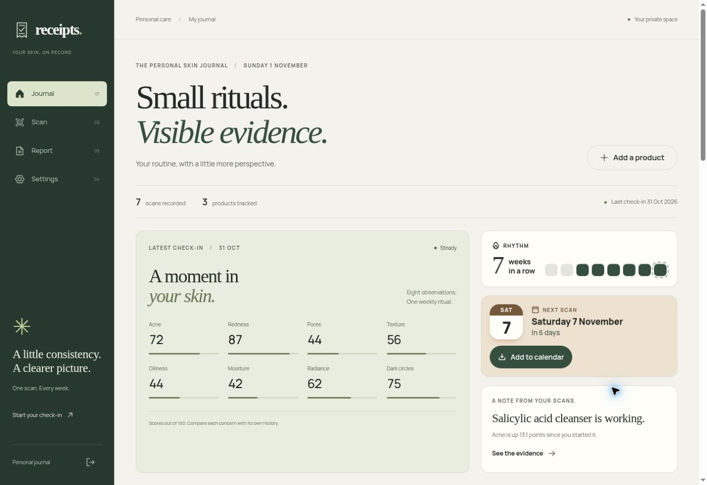
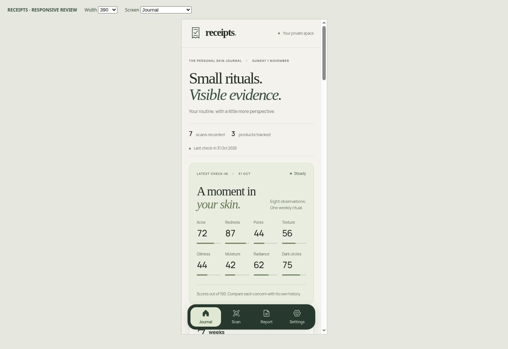

# Receipts — Field Notes redesign

A personal skincare journal built around warm paper, botanical ink, editorial serif headings, Manrope UI text, fine rules, and compact evidence ledgers. Desktop uses a persistent sidebar and asymmetric workspaces; phones use a branded header, stacked sections, and labelled bottom navigation.

## Screen coverage

- Login and email form states, SSO callback
- Journal, first-scan onboarding, empty product shelf, milestones and ideas
- Product detail, all five verdicts, comparison, missing products
- Add/edit product, concern selection and overlap warnings
- Scan capture, unavailable/processing states and saved scan results
- Settings, reminders, confirmation dialogs
- Printable report and unsubscribe success/error states
- Shared loading, offline, navigation and PWA identity

## Validation

- Production TypeScript/Vite build passes.
- 21 test files / 263 tests pass.
- Oxlint passes with the existing buttonVariants Fast Refresh export warning.
- Local browser review at 320, 390, 768, 1024 and 1440px using seeded demo data and mocked Clerk/Convex hooks; no document-level horizontal overflow in checked routes. Wide report tables retain their own scroll container.
- Product create/edit navigation and canceling a destructive confirmation were exercised locally.
- The scan result was inspected with fixture data. Live authentication, camera permission, paid scan processing, email delivery, account deletion and real backend writes were not exercised.
- Temporary preview fixtures and mock credentials are excluded from the change. Production API bindings and auth flow remain in place.

Also fixes the product-detail overlap call to pass the current product ID, so it cannot warn that a product overlaps itself. Removes a duplicate product-empty prompt.

## Preview

Screenshots use fixture data, not a real person's account.

