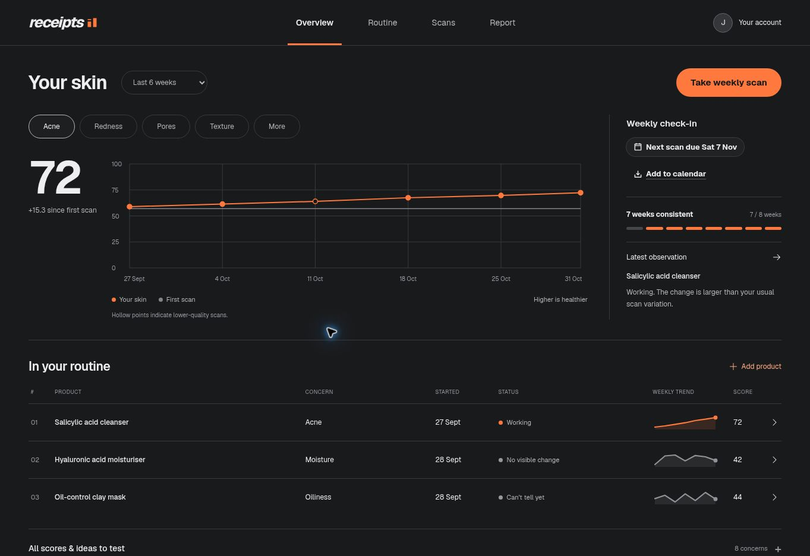
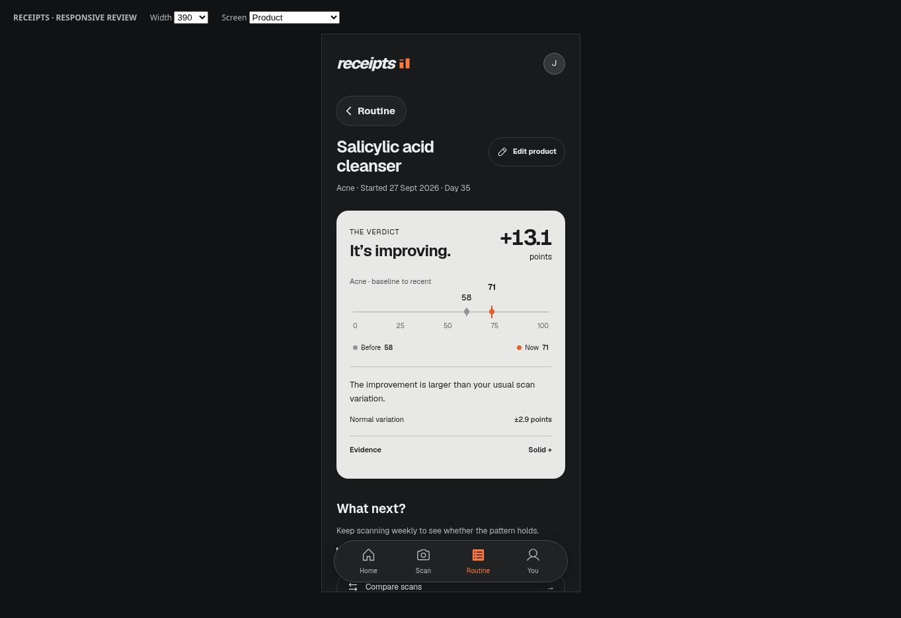

# Receipts — graphite redesign

Implements the approved graphite, silver, and orange desktop/mobile direction.

## Screens

- Overview with concern and date-range controls, measured score chart, weekly check-in, and routine rows.
- Dedicated routine route, product evidence (all five verdicts), and before/now comparison.
- Add/edit product, capture, processing/error states, scan result, and read-only scan availability.
- Login/sign-up/verification, SSO transition, account/reminders, unsubscribe, and printable report.
- Responsive navigation, loading/empty states, confirmation dialogs, and app icons.

Charts use saved measurements on a 0–100 scale. Hollow points identify lower-quality scans. The comparison table explicitly describes its unweighted averages; verdicts continue to come from the existing engine. Irritation labels and variation use the worsening concern.

## Validation

- Production TypeScript/Vite build passes.
- Lint passes with the existing Fast Refresh export warning in `button.tsx`.
- All 263 tests across 21 files pass.
- Browser review at desktop 1363px, tablet 768/1024px, and phone 390/320px. Checked for horizontal overflow on narrow forms, report, login, settings, capture, product/compare, routine, and unsubscribe screens.
- Exercised concern/range controls, expanded evidence/content, local product creation, reminder preview, and confirmation cancellation. Checked all five verdicts, empty journal, edit form, and read-only demo capture.
- Browser fixtures use the repository demo data and actual verdict calculation, with explicit fixture overrides for early/irritation states. Screenshots below show synthetic data.
- Live Clerk authentication, email delivery, native camera permissions, paid YouCam scans, and the OS print dialog were not exercised. No backend or deployment configuration changed.

## Screenshots

